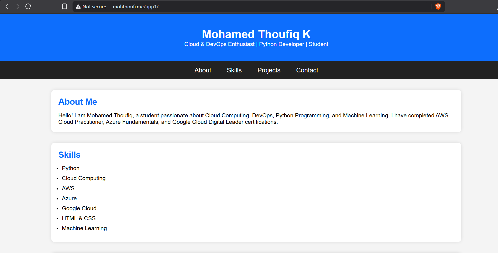

# Enterprise Cloud DevOps Platform with Automated Backup & High Availability

## Project Overview

This project demonstrates the deployment of a highly available web application on AWS using industry-standard cloud architecture.

The infrastructure is designed with redundancy, scalability, monitoring, automated backup, and disaster recovery concepts commonly used in enterprise environments.

---

## AWS Services Used

- Amazon VPC
- Public & Private Subnets
- Internet Gateway
- NAT Gateway
- Security Groups
- Amazon EC2
- Amazon EFS
- Application Load Balancer
- Auto Scaling Group
- Amazon CloudWatch
- Amazon SNS
- Amazon S3
- Amazon Route 53
- Amazon CloudFront
- IAM
- Cron Job Automation

---

## Architecture

```
                    Internet
                        │
                  Amazon Route53
                        │
                  Amazon CloudFront
                        │
            Application Load Balancer
                        │
            ┌───────────┴───────────┐
            │                       │
         EC2 Instance 1        EC2 Instance 2
            │                       │
            └───────────┬───────────┘
                        │
                  Amazon EFS
                        │
                Website Files
                        │
            Cron Backup (EC2-1)
                        │
                   Amazon S3
```

---

## Features

- High Availability Architecture
- Shared Storage using Amazon EFS
- Application Load Balancing
- Auto Scaling
- DNS Management using Route53
- Global Content Delivery using CloudFront
- CloudWatch Monitoring
- SNS Email Notifications
- Automated Website Backup
- Disaster Recovery using Amazon S3

---

## Infrastructure

### Networking

- Custom VPC
- Public Subnets
- Private Subnets
- Internet Gateway
- NAT Gateway
- Route Tables

### Compute

- Two Amazon Linux 2023 EC2 Instances
- Apache HTTP Server
- IAM Roles

### Storage

- Amazon EFS
- Amazon S3 Backup Bucket

### Load Balancing

- Application Load Balancer
- Health Checks
- Target Groups

### Monitoring

- CloudWatch Dashboard
- CPU Monitoring
- Network Monitoring
- CloudWatch Alarms

### Notification

- Amazon SNS Email Alerts

### Backup

A cron job runs automatically every day.

```
Backup Website

↓

Compress Website

↓

Upload ZIP

↓

Amazon S3
```

---

## Technologies Used

- AWS
- Linux
- Apache
- Bash
- Cron
- HTML
- CSS

---

## Backup Script

```bash
#!/bin/bash

DATE=$(date +%F)

zip -r website-$DATE.zip /var/www/html

aws s3 cp website-$DATE.zip s3://my-webby-backup/backups/

rm -f website-$DATE.zip

echo "Backup Completed"
```

---

---

## Output 


## Project Workflow

```
User

↓

Route53

↓

CloudFront

↓

Application Load Balancer

↓

EC2 Instances

↓

Amazon EFS

↓

CloudWatch

↓

SNS

↓

Amazon S3 Backup
```

---

## Learning Outcomes

- AWS Networking
- EC2 Administration
- High Availability Design
- Shared Storage using EFS
- Load Balancing
- Auto Scaling
- Monitoring & Alerting
- Automated Backup
- Disaster Recovery
- Cloud Infrastructure Deployment

---

## Future Improvements

- Terraform Infrastructure as Code
- Docker Containerization
- Kubernetes Deployment
- Jenkins CI/CD Pipeline
- AWS CodePipeline
- AWS Systems Manager Automation

---

## Author

Mohamed Thoufiq K

Aspiring Cloud & DevOps Engineer

LinkedIn:
www.linkedin.com/in/mohamed-thoufiq-3665ba255

GitHub:
[(Add your GitHub Profile)](https://github.com/Mohamedthoufiq31/enterprise-cloud-devops-platform)

