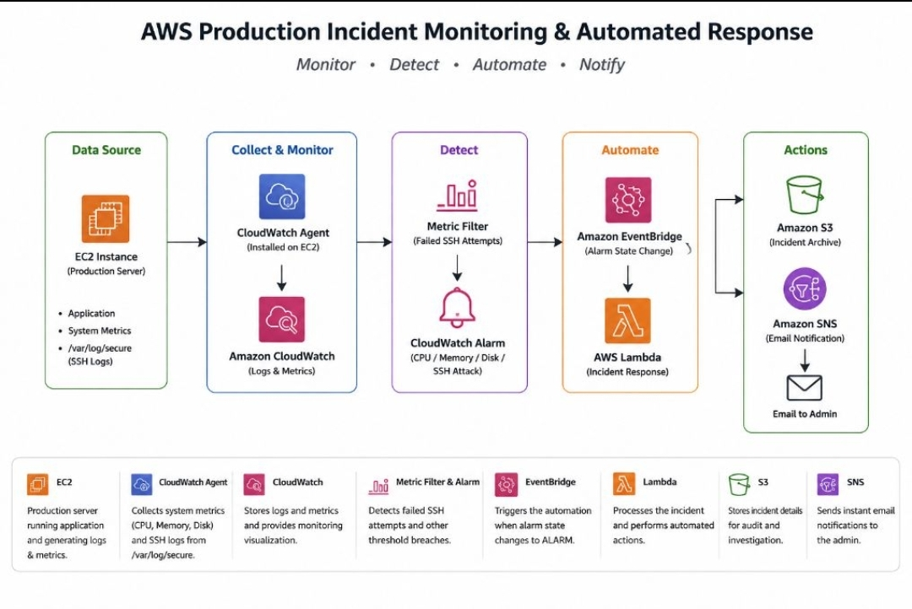
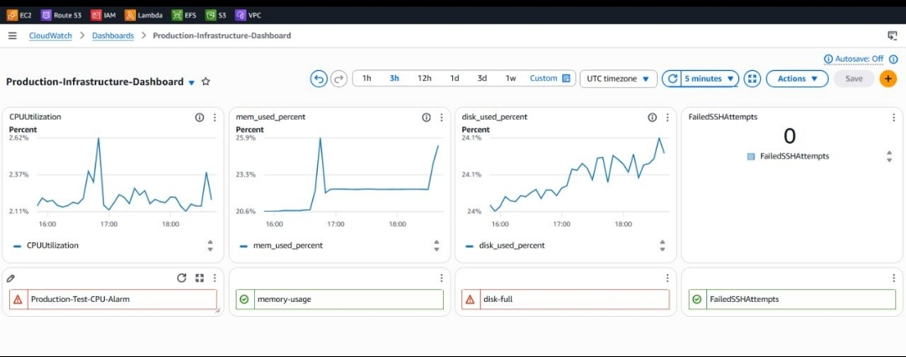
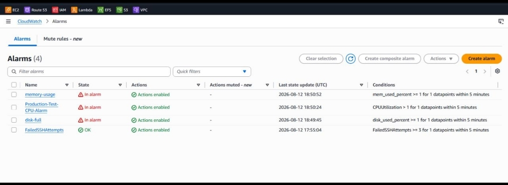
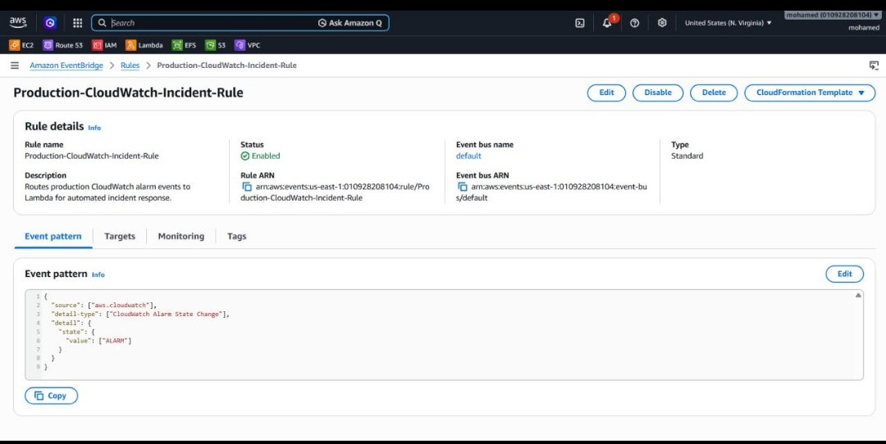
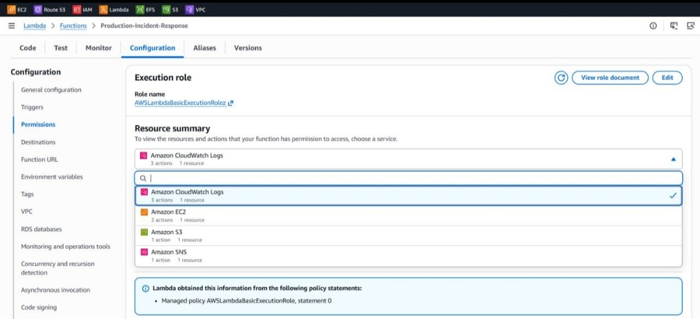
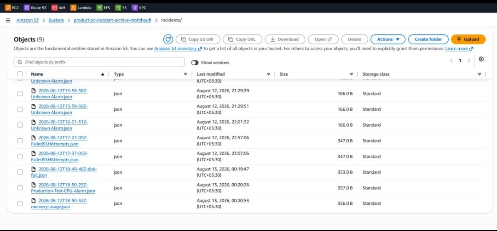
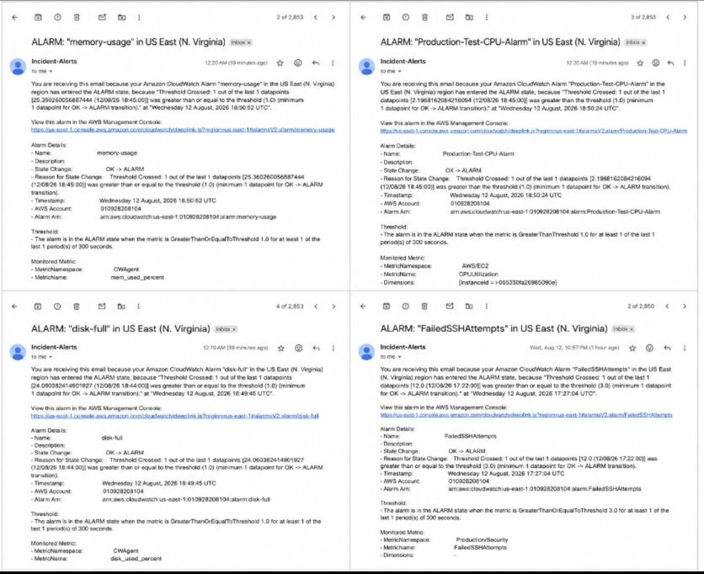

# Enterprise AWS Production Observability, Security & Automated Incident Response

## Project Overview

This project demonstrates a production-oriented AWS observability, security monitoring, and automated incident response solution.

The objective is to monitor AWS EC2 infrastructure, detect operational and security-related events, automate incident response, archive incident records in Amazon S3 in JSON format, and send real-time notifications using AWS managed services.

The solution integrates monitoring, event-driven automation, serverless computing, centralized logging, and persistent incident storage to improve infrastructure visibility and reduce manual intervention.

## Architecture

### Workflow

**EC2 → CloudWatch / CloudWatch Agent → CloudWatch Alarms → EventBridge → Lambda → S3 + SNS**



## AWS Services Used

| AWS Service | Purpose |
|---|---|
| Amazon EC2 | Hosts the application infrastructure |
| Amazon CloudWatch | Infrastructure monitoring and dashboards |
| CloudWatch Agent | Collects memory, disk and log metrics |
| CloudWatch Alarms | Detects infrastructure and security events |
| Amazon EventBridge | Event-driven automation and event routing |
| AWS Lambda | Executes automated incident response actions |
| Amazon S3 | Stores archived incident records in JSON format |
| Amazon SNS | Sends real-time incident notifications |
| CloudWatch Logs | Collects and monitors SSH and Apache logs |
| AWS IAM | Manages secure service-to-service permissions |

## Implementation Screenshots

### 1. CloudWatch Monitoring Dashboard

CloudWatch dashboards provide centralized visibility into EC2 infrastructure metrics and system performance.




### 2. CloudWatch Alarms

Configured CloudWatch alarms to monitor infrastructure metrics and detect abnormal conditions and security-related events.



### 3. EventBridge Automation

Amazon EventBridge identifies configured events and triggers the Lambda function to initiate automated incident response.



### 4. Lambda Incident Response

AWS Lambda processes incoming events and performs automated incident response actions.



### 5. Amazon S3 – JSON Incident Log Archiving

Incident details are archived in Amazon S3 as structured JSON records for persistent storage, future reference, auditing, and troubleshooting.



### 6. Amazon SNS Notifications

Amazon SNS delivers real-time notifications about detected incidents to configured recipients.



## Incident Response Workflow

1. **Infrastructure Monitoring:** EC2 generates infrastructure metrics and system logs.
2. **Metric and Log Collection:** CloudWatch Agent collects memory, disk, and application log information.
3. **Incident Detection:** CloudWatch Alarms monitor configured thresholds and security-related events.
4. **Event Processing:** EventBridge detects matching events and triggers the configured Lambda function.
5. **Automated Response:** Lambda processes the triggered incident and executes the configured response actions.
6. **Incident Archiving:** Lambda stores incident details as structured JSON files in an Amazon S3 bucket.
7. **Real-Time Notifications:** Amazon SNS sends incident notifications to configured recipients.

## Automated Incident Log Archiving

This project implements automated incident log archiving using AWS Lambda and Amazon S3.

Key features:

- Lambda processes incident events triggered through EventBridge.
- Incident information is structured into JSON format.
- JSON incident records are automatically uploaded to Amazon S3.
- S3 provides persistent storage for historical incident records.
- Archived incident records can be retrieved for future auditing and troubleshooting.

Example S3 storage structure:

```text
incident-logs/
│
└── 2026/
    └── 11/
        ├── incident-20261102-001.json
        ├── incident-20261102-002.json
        └── incident-20261102-003.json
```

*Note: This is an illustrative storage structure. Actual object keys depend on the implemented S3 upload logic.*

## Security Implementation

- IAM roles and permissions for secure AWS service integration.
- Controlled access between EventBridge, Lambda, S3, and SNS.
- CloudWatch log monitoring for SSH and Apache activity.
- Monitoring of configured infrastructure and security events.

## Key Learnings

- AWS infrastructure monitoring and observability.
- CloudWatch metrics, dashboards, and alarms.
- CloudWatch Agent configuration and system-level monitoring.
- Centralized log collection using CloudWatch Logs.
- Event-driven automation using Amazon EventBridge.
- Serverless incident response using AWS Lambda.
- Automated JSON log archiving using Amazon S3.
- Real-time notifications using Amazon SNS.
- IAM roles and least-privilege access management.
- Automated incident detection and response workflows.

## Project Outcome

Successfully demonstrated an AWS-based production observability and automated incident response workflow.

The solution integrates infrastructure monitoring, event-driven automation, serverless incident processing, JSON-based incident log archiving, and real-time notifications.

This project provides practical experience in AWS Cloud, DevOps, Observability, Security Monitoring, Automation, and Incident Response.

## Technologies

**AWS | EC2 | CloudWatch | CloudWatch Agent | EventBridge | Lambda | S3 | SNS | IAM | JSON | DevOps | Observability | Security | Incident Response**
