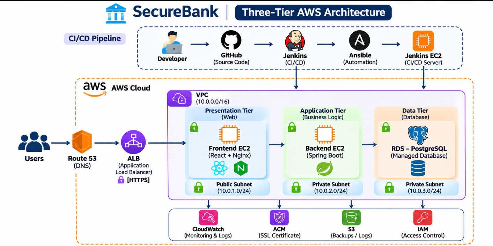

# 🏦 SecureBank – Three-Tier AWS DevOps Project

<p>


</p>

Designed and deployed a **Three-Tier Banking Application** on AWS using **Docker, Jenkins CI/CD, and Ansible Automation**.

This project demonstrates how to develop, containerize, deploy, and automate a full-stack banking application using AWS infrastructure and DevOps tools.

The architecture includes separate application and Jenkins EC2 instances, an Application Load Balancer, HTTPS configuration, Docker Compose services, and automated application deployment.

> **Note:** SecureBank is an educational banking simulation. Account balances and fund transfers are fictional. This is not a real banking or payment platform.

---

## 📌 Project Overview

In this project, I learnt and implemented how to:

- Develop a full-stack banking application.
- Build a responsive frontend using React and TypeScript.
- Develop REST APIs using Spring Boot and Java.
- Integrate PostgreSQL for database management.
- Containerize applications using Docker.
- Manage multiple containers using Docker Compose.
- Launch and configure AWS EC2 instances.
- Configure an Application Load Balancer.
- Configure HTTPS using AWS Certificate Manager.
- Connect a custom domain using Amazon Route 53.
- Configure Nginx as a reverse proxy.
- Automate server configuration using Ansible.
- Create Jenkins CI/CD pipelines.
- Deploy application updates using SSH.
- Monitor and troubleshoot application deployments.

---

## 🏦 Banking Application Features

The SecureBank application simulates a modern digital banking experience.

### User Authentication
- User registration.
- Email OTP verification.
- User login and logout.
- Session-based authentication.
- Protected application pages.

### Banking Dashboard
- Account balance display.
- Hide and show balance.
- Account information.
- Recent transaction details.
- Dashboard navigation.

### Fund Transfer
- Simulated fund transfers.
- Beneficiary selection.
- Transfer amount entry.
- Transaction recording.
- Transfer history.

### Beneficiary Management
- Add beneficiaries.
- View beneficiary details.
- Manage saved beneficiaries.
- Select beneficiaries for transfers.

### Transaction Management
- Transaction history.
- Transaction details.
- Transaction statements.
- Simulated transaction records.

### Additional Features
- Profile management.
- Admin dashboard.
- QR-related interface.
- Responsive design.
- Theme options.

---

## 🛠️ Technologies Used

### Frontend
- React
- TypeScript
- Vite
- HTML
- CSS
- Nginx

### Backend
- Java 21
- Spring Boot 3.4.4
- REST APIs
- Flyway

### Database
- PostgreSQL 16

### DevOps Tools
- Docker
- Docker Compose
- Jenkins
- Ansible
- Git
- GitHub
- SSH

### AWS Services
- Amazon VPC
- Public and Private Subnets (as configured in the deployment)
- Security Groups
- Amazon EC2
- Application Load Balancer
- Target Groups
- AWS Certificate Manager
- Amazon Route 53

---

## Architecture

<p align="center">
  
</p>

### Architecture Components

| Component | Purpose |
|---|---|
| Route 53 | Domain name resolution |
| Application Load Balancer | Distributes incoming application traffic |
| ACM | HTTPS certificate management |
| Application EC2 | Hosts banking application containers |
| Jenkins EC2 | Runs CI/CD pipelines |
| Nginx | Serves frontend and proxies API requests |
| Spring Boot | Handles backend business logic |
| PostgreSQL | Stores application data |
| Docker Compose | Manages application containers |
| Ansible | Automates server configuration |

---

## AWS Deployment Details

| Configuration | Details |
|---|---|
| AWS Region | US East (N. Virginia) |
| Region Code | us-east-1 |
| Application Server | Ubuntu 24.04 EC2 |
| Jenkins Server | Ubuntu 24.04 EC2 |
| Application Port | 80 through Nginx |
| Backend Port | 8080 |
| Database Port | 5432 |
| Jenkins Port | 8080 |
| Public Access | Application Load Balancer |
| Domain | securebank.mohthoufi.me |

---

## Step 1: Clone the GitHub Repository

```bash
git clone https://github.com/Mohamedthoufiq31/securebank-3-tier-devops.git

cd securebank-3-tier-devops
```

---

## Step 2: Configure Environment Variables

Create the environment file.

### Linux / WSL

```bash
cp .env.example .env
```

### Windows PowerShell

```powershell
Copy-Item .env.example .env
```

Configure the required database credentials and application settings.

**Important:** Never upload `.env` files, passwords, SSH private keys, or other secrets to GitHub.

---

## Step 3: Run the Application Locally

Build and start the application using Docker Compose.

```bash
docker compose up -d --build
```

Check running containers:

```bash
docker compose ps
```

View application logs:

```bash
docker compose logs -f
```


## Step 4: Launch AWS EC2 Instances

Launch two separate EC2 instances.

| Instance | Purpose |
|---|---|
| Application EC2 | Runs SecureBank application |
| Jenkins EC2 | Runs Jenkins CI/CD |

Operating System:

```text
Ubuntu 24.04
```

---

## Step 5: Configure Application EC2

Connect to the application server.

```bash
ssh -i your-key.pem ubuntu@<EC2-PUBLIC-IP>
```

Update packages:

```bash
sudo apt update
sudo apt upgrade -y
```

Install Git:

```bash
sudo apt install git -y
```

Install Docker Engine and Docker Compose using the official Docker Ubuntu installation instructions.

Verify:

```bash
docker --version

docker compose version

git --version
```

Create the application directory:

```bash
sudo mkdir -p /opt/securebank

sudo chown ubuntu:ubuntu /opt/securebank
```

Clone the repository:

```bash
git clone https://github.com/Mohamedthoufiq31/securebank-3-tier-devops.git /opt/securebank
```

Configure the required environment file securely.

Start the application:

```bash
cd /opt/securebank

docker compose up -d --build
```

Verify:

```bash
docker compose ps
```

---

## Step 6: Configure Docker Compose

The application contains three main services.

| Service | Technology | Responsibility |
|---|---|---|
| frontend | React + Nginx | User interface |
| backend | Spring Boot | REST API |
| postgres | PostgreSQL | Database |

The services communicate through the Docker Compose network.

```text
Docker Compose
     |
     +---- Frontend
     |       |
     |      Nginx
     |
     +---- Backend
     |       |
     |   Spring Boot
     |
     +---- Database
             |
         PostgreSQL
```

Useful commands:

```bash
docker compose up -d

docker compose ps

docker compose logs -f

docker compose down
```

---

## Step 7: Configure Application Load Balancer

Navigate to:

```text
AWS Console
    |
    v
EC2
    |
    v
Load Balancers
    |
    v
Create Load Balancer
    |
    v
Application Load Balancer
```

Configure:

- Internet-facing load balancer.
- IPv4.
- Required Availability Zones and subnets.
- ALB security group.
- HTTP listener on port 80.
- HTTPS listener on port 443.
- Application target group.

### Listener Configuration

| Listener | Action |
|---|---|
| HTTP :80 | Redirect to HTTPS :443 |
| HTTPS :443 | Forward to securebank-tg |

Register the application EC2 instance in the target group.

Verify that the target health status becomes:

```text
Healthy
```

---

## Step 8: Configure HTTPS Using ACM

Navigate to:

```text
AWS Console
    |
    v
AWS Certificate Manager
    |
    v
Request Certificate
```

Request a certificate for:

```text
securebank.mohthoufi.me
```

Complete DNS validation.

Attach the issued certificate to the ALB HTTPS listener.

The certificate must be in the same AWS Region as the ALB.

---

## Step 9: Configure Amazon Route 53

Navigate to:

```text
AWS Console
    |
    v
Route 53
    |
    v
Hosted Zones
    |
    v
Select Domain
```

Create an Alias record pointing to the Application Load Balancer.

Access the application:

```text
https://securebank.mohthoufi.me
```

---

## Step 10: Configure Ansible Automation

Ansible is used from WSL Ubuntu 24.04.

Install Ansible:

```bash
sudo apt update

sudo apt install ansible -y
```

Verify:

```bash
ansible --version
```

### Inventory Configuration

Example `inventory.ini`:

```ini
[securebank]
securebank-ec2 ansible_host=YOUR_EC2_HOST

[securebank:vars]
ansible_user=ubuntu
ansible_ssh_private_key_file=/path/to/your/private-key.pem
ansible_python_interpreter=/usr/bin/python3
```

### Test Connectivity

```bash
ansible securebank -m ping
```

Expected result:

```text
securebank-ec2 | SUCCESS => {
    "changed": false,
    "ping": "pong"
}
```

### Execute Playbook

```bash
ansible-playbook -i inventory.ini your-playbook.yml
```

Ansible automates repeatable server configuration and application deployment tasks.

---

## Step 11: Configure Jenkins CI/CD

Jenkins is installed on a separate EC2 instance.

Create a Jenkins Pipeline job:

```text
Job Name: SecureBank-CI-CD
Branch: main
Credential ID: securebank-ec2-ssh
Username: ubuntu
```

### CI/CD Workflow

```text
GitHub Repository
       |
       v
Jenkins Pipeline
       |
       v
SSH to Application EC2
       |
       v
Git Pull
       |
       v
Validate Docker Compose
       |
       v
Build and Deploy
       |
       v
Verify Containers
```

### Deployment Commands

The remote deployment stage runs commands equivalent to:

```bash
cd /opt/securebank

git pull origin main

docker compose config -q

docker compose up -d --build

docker compose ps
```

### Poll SCM

Configured polling schedule:

```text
H/5 * * * *
```

This checks the GitHub repository periodically when Poll SCM is enabled.

Verify automatic triggering separately by pushing a test commit and checking the Jenkins build history.

---

## Step 12: Verify the Deployment

### Check Docker Containers

```bash
cd /opt/securebank

docker compose ps
```

### Check Backend Health

```bash
curl -i http://localhost:8080/actuator/health
```

Expected response:

```json
{
  "status": "UP"
}
```

### Check Application Website

```text
https://securebank.mohthoufi.me
```

### Check Ansible

```bash
ansible securebank -m ping
```

### Check Jenkins

Open the Jenkins dashboard and verify the latest pipeline build.

---

## Useful Commands Summary

### Docker

```bash
docker ps

docker images

docker compose ps

docker compose logs -f

docker compose restart

docker compose up -d --build

docker compose down
```

### Linux

```bash
df -h

free -h

top

systemctl status docker

systemctl status nginx
```

### Git

```bash
git status

git pull origin main

git add .

git commit -m "Update SecureBank"

git push origin main
```

### Ansible

```bash
ansible --version

ansible securebank -m ping

ansible-playbook -i inventory.ini your-playbook.yml
```

---

## Security Groups

The following table describes the intended network access.

| Resource | Port | Source |
|---|---|---|
| ALB | 80 | Public Internet |
| ALB | 443 | Public Internet |
| Application EC2 | 22 | Administrator IP and required Jenkins security group |
| Application EC2 | 80 | ALB Security Group |
| Jenkins EC2 | 22 | Administrator IP |
| Jenkins EC2 | 8080 | Administrator IP only |
| PostgreSQL | 5432 | Internal Docker network |

Backend and database services should not be exposed directly to the public internet.

---

## Troubleshooting

### Docker Containers Not Running

```bash
docker compose ps

docker compose logs --tail=100
```

### Backend Health Check Failure

```bash
docker compose logs backend
```

Check database connectivity and application environment variables.

### Ansible SSH Error

```bash
ansible securebank -m ping -vv
```

Verify the inventory, SSH key, username, and security group.

### Jenkins Deployment Failure

Check:

- Jenkins SSH credential configuration.
- Application EC2 authorized public key.
- SSH connectivity.
- Application directory.
- Docker Compose availability.

### Website Not Accessible

Check:

1. EC2 instance state.
2. Docker container status.
3. ALB listener configuration.
4. Target group health.
5. Security groups.
6. ACM certificate.
7. Route 53 DNS configuration.

---

## 💰 AWS Cost Management

AWS resources can incur charges even when the application is not being accessed.

Important points:

- Stopping EC2 instances generally stops compute charges.
- EBS volumes may continue to incur storage charges.
- Application Load Balancers can continue to incur charges.
- Public IPv4 addresses, snapshots, and data transfer may also incur costs.
- AWS Budgets provides alerts but does not automatically stop spending.

Review the AWS Billing dashboard before leaving the environment unused.

---

## Future Improvements

- Add automated frontend and backend testing.
- Integrate security and dependency scanning.
- Implement centralized monitoring using CloudWatch.
- Add automated database backups.
- Improve deployment rollback.
- Strengthen secrets management.
- Explore Auto Scaling and high availability.
- Evaluate managed database services.
- Explore Infrastructure as Code using Terraform or CloudFormation.

These are future enhancements, not services claimed as implemented in the current deployment.

---

## Learning Outcomes

Through this project, I gained practical experience with:

- Three-tier application architecture.
- AWS EC2 deployment.
- Application Load Balancer configuration.
- HTTPS and DNS configuration.
- Docker and Docker Compose.
- Nginx reverse proxy.
- Jenkins CI/CD pipelines.
- Ansible automation.
- SSH-based deployment.
- Linux server administration.
- Git and GitHub workflows.
- Cloud security and cost management.

---

## 👨‍💻 Author

**Mohamed Thoufiq K**

- GitHub: [Mohamedthoufiq31](https://github.com/Mohamedthoufiq31)
- Project Repository: [SecureBank](https://github.com/Mohamedthoufiq31/securebank-3-tier-devops)


---

## ⭐ Support

If you found this project useful for learning AWS, Docker, Jenkins, and Ansible, please consider giving this repository a star ⭐.

Your support is greatly appreciated!

---

<p align="center">
<strong>Learn • Build • Automate • Deploy</strong>
</p>
